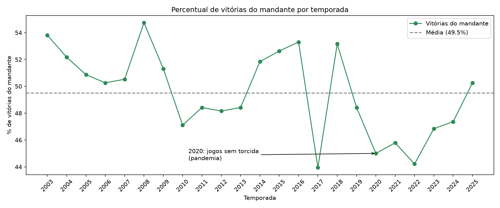
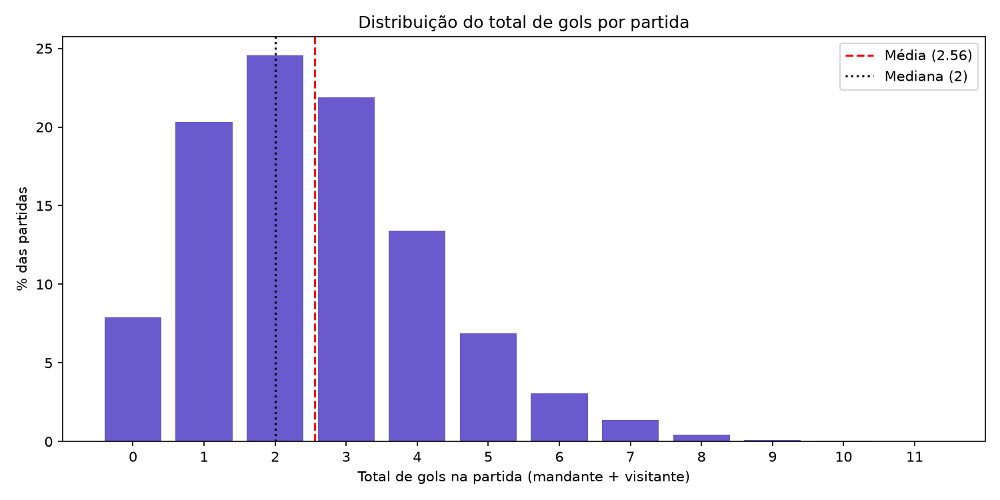

# Projeto de Data Analytics - RA3: Campeonato Brasileiro de Futebol

Terceira etapa (**RA3**) do projeto de Data Analytics. Utiliza a base do Campeonato Brasileiro Série A (pontos corridos, 2003–2025) preparada nas etapas anteriores para realizar análise estatística descritiva, visualizações, análise de representatividade e uma aplicação de Machine Learning.

# Alunos:
## Lucas Brisch Zanlorenzi
## Livia Rosembach Oliveira
## Alexandre Andrioli Tucci

## Problema investigado

> **Existe vantagem para o time mandante (fator casa) no Campeonato Brasileiro? É possível prever se o mandante vencerá uma partida a partir do desempenho recente das equipes?**

## 📋 Estrutura do Repositório
- `campeonato_brasileiro.csv`: base de dados tratada nas etapas anteriores.
- `RA3.py`: script com a análise estatística, geração dos gráficos e o modelo de Machine Learning.
- `requirements.txt`: dependências Python.
- `grafico_1_distribuicao_gols.png`, `grafico_2_resultados_partidas.png`, `grafico_3_vitorias_mandante_temporada.png`, `grafico_4_distribuicao_total_gols.png`: gráficos gerados pelo script.

## Instruções de Execução

Requer Python 3.9 ou superior.

```bash
pip install -r requirements.txt
python RA3.py
```

O script imprime no terminal todas as tabelas e métricas citadas abaixo e salva os quatro gráficos (`.png`) na pasta do projeto.

> Observação: o resultado de cada partida (vitória do mandante / empate / vitória do visitante) é calculado a partir do **placar**, e não da coluna `vencedor`, porque essa coluna tem 541 partidas em que o nome do vencedor está escrito diferente do nome do time (ex.: "Atletico-MG" x "Atlético-MG", "Sport" x "Sport Recife", "America-MG" x "América-MG"), o que distorceria os percentuais.

---

## 1. Análise Estatística Descritiva

Variáveis analisadas: gols do mandante, gols do visitante e total de gols por partida (9.165 partidas).

| Medida | Gols mandante | Gols visitante | Total de gols |
|---|---|---|---|
| **Média** | 1,54 | 1,03 | 2,56 |
| **Mediana** | 1 | 1 | 2 |
| **Moda** | 1 | 0 | 2 |
| **Desvio-padrão** | 1,23 | 1,03 | 1,63 |
| **Mínimo / Máximo** | 0 / 8 | 0 / 7 | 0 / 11 |
| **Amplitude** | 8 | 7 | 11 |
| **Q1 / Q3** | 1 / 2 | 0 / 2 | 1 / 4 |

**Tendência central.** O mandante marca em média 1,54 gol por jogo, cerca de **50% a mais** que o visitante (1,03). Como gols são valores inteiros e pequenos, a mediana fica igual (1) para os dois; por isso a média e a moda ajudam mais a ver a diferença: o valor mais comum para o mandante é marcar 1 gol, e para o visitante é **não marcar** (0).

**Dispersão.** O desvio-padrão é alto em relação à média (1,23 para média de 1,54 no mandante), o que mostra que o número de gols varia bastante de jogo para jogo. A amplitude (até 8 gols) é causada por poucos jogos extremos; o intervalo entre Q1 e Q3 mostra que metade das partidas tem entre 1 e 4 gols no total.

**Distribuição.** A distribuição dos gols é assimétrica à direita (concentrada em 0–2 gols e com cauda longa; ver também o Gráfico 4):

| Gols | 0 | 1 | 2 | 3 | 4 | 5+ |
|---|---|---|---|---|---|---|
| Mandante (% partidas) | 20,7 | 34,2 | 25,4 | 12,7 | 4,9 | 2,0 |
| Visitante (% partidas) | 36,3 | 36,0 | 19,1 | 6,2 | 1,9 | 0,4 |

Resultados das partidas: **Vitória do mandante 49,6%**, Empate 26,4%, Vitória do visitante 23,9%. Placares mais frequentes: 1x0 (13,2%), 1x1 (12,4%), 2x1 (9,8%), 2x0 (8,4%) e 0x0 (7,9%) — os quatro mais comuns com gols são favoráveis ou neutros para o mandante.

**No contexto do problema:** o mandante vence aproximadamente o dobro de vezes que o visitante, o que indica a existência do fator casa.

---

## 2. Visualização e Interpretação dos Dados

### Gráfico 1 – Distribuição de gols por partida (mandante x visitante)


**Interpretação:** as barras do visitante são maiores em 0 e 1 gol, e as do mandante são maiores a partir de 2 gols. O visitante passa em branco em 36,3% dos jogos, contra 20,7% do mandante. A distribuição do mandante é deslocada para valores mais altos — o mandante não só vence mais, como marca mais.

### Gráfico 2 – Proporção dos resultados


**Interpretação:** quase metade dos jogos (49,6%) termina com vitória do mandante, enquanto empate e vitória do visitante ficam próximos (26,4% e 23,9%). É a evidência mais direta do fator casa.

### Gráfico 3 – Percentual de vitórias do mandante por temporada


**Interpretação:** o percentual de vitórias do mandante oscila entre 43,9% (2017) e 54,7% (2008), mas em **todas** as temporadas fica bem acima da média geral de vitórias do visitante (23,9%), ou seja, o fator casa é consistente ao longo do tempo. Também se observa uma tendência de queda nas temporadas mais recentes (2019–2024 abaixo da média). Em 2020, temporada disputada sem torcida por causa da pandemia, o índice caiu para 45,0%, abaixo da média — o que é compatível com a ideia de que a torcida contribui para o fator casa, mas não prova isso, pois 2017 e 2022 tiveram valores semelhantes com público.

### Gráfico 4 – Distribuição do total de gols por partida


**Interpretação:** o total de gols se concentra entre 1 e 4 gols (80,1% das partidas), com pico em 2 gols (24,5%). A distribuição é **assimétrica à direita**: há uma cauda de jogos com muitos gols (até 11), e por isso a média (2,56) fica acima da mediana (2). Jogos sem gols são incomuns (7,9%) e 47,2% das partidas têm 3 gols ou mais. Isso mostra que os jogos com 5 gols ou mais (cerca de 12% das partidas) puxam a média para cima, e que a mediana descreve melhor o "jogo típico".

---

## 3. Amostragem e Representatividade

- **Origem e abrangência:** base pública consolidada do Campeonato Brasileiro Série A, com **todas as partidas da era dos pontos corridos (2003 a 2025)**, totalizando 9.165 jogos de 46 clubes. **Não foi utilizada amostragem**: trabalhamos com a população completa do período.
- **Representatividade:** como contém todos os jogos do período, representa bem o problema investigado (fator casa na Série A). Os resultados **não** devem ser generalizados para outras divisões, copas ou outros países.
- **Limitações e vieses:**
  - **Formato diferente nas primeiras temporadas:** 2003 e 2004 tiveram 24 clubes (552 jogos) e 2005 teve 22 (462 jogos); a partir de 2006 são 20 clubes (380 jogos). As primeiras temporadas têm mais peso no total.
  - **2016 tem 379 jogos:** a última partida da Chapecoense não foi disputada após o acidente aéreo do clube.
  - **Temporada 2020** foi disputada entre agosto/2020 e fevereiro/2021 (pandemia). O script corrige isso para não misturar jogos de 2020 com os de 2021.
  - **Colunas incompletas:** `arrecadacao` tem 95,9% de valores ausentes e as formações táticas estão como "Não Informado" em 54,3% dos jogos; por isso essas colunas não foram usadas.
  - **Inconsistência na coluna `vencedor`** (541 jogos com nome divergente); contornada usando o placar.
  - A base não traz variáveis como público, elenco, lesões ou distância de viagem, que também influenciam o resultado.

---

## 4. Aplicação de Machine Learning

**Abordagem:** Classificação, com **Regressão Logística** (scikit-learn).

1. **Problema preditivo:** prever, antes do jogo, se o **mandante vai vencer** (1) ou **não vai vencer** — empate ou derrota (0).
2. **Target:** `mandante_venceu`.
3. **Features** (calculadas apenas com jogos **anteriores** à partida, para não usar informação do futuro):
   - `mand_pts_ult5`: média de pontos do mandante nos últimos 5 jogos;
   - `mand_saldo_ult5`: saldo de gols médio do mandante nos últimos 5 jogos;
   - `visit_pts_ult5` e `visit_saldo_ult5`: as mesmas medidas para o visitante.

   Foram removidas 170 partidas em que algum time ainda não tinha 5 jogos de histórico (início da base e times recém-chegados), restando 8.995.
4. **Separação treino/teste:** temporal — **treino com 2003–2021** (7.480 jogos) e **teste com 2022–2025** (1.515 jogos). Assim o modelo é avaliado como seria usado na prática: aprende com o passado e prevê o futuro.
5. **Avaliação:** acurácia, comparada com baselines, e matriz de confusão.

| Modelo | Acurácia (teste) |
|---|---|
| Baseline 1 – sempre prever a classe mais comum do treino ("vence") | 47,2% |
| Baseline 2 – sempre prever a classe mais comum do teste ("não vence") | 52,8% |
| **Regressão Logística** | **56,0%** |

Matriz de confusão (teste):

| | Previsto: não venceu | Previsto: venceu |
|---|---|---|
| **Real: não venceu** | 429 | 371 |
| **Real: venceu** | 296 | 419 |

Precisão / recall da classe "venceu": 0,53 / 0,59. F1 médio: 0,56.

**Interpretação:** o modelo acerta 56% das previsões, superando as duas referências simples, o que mostra que o desempenho recente das equipes tem **algum** poder preditivo. Os coeficientes fazem sentido: saldo de gols recente do mandante aumenta a chance de vitória e o bom momento do visitante a reduz. Porém o ganho é modesto (cerca de 3 pontos percentuais acima de sempre prever "não vence"): o resultado de um jogo de futebol tem muita aleatoriedade e depende de fatores que não estão na base. O modelo ainda erra bastante — prevê vitória em 371 jogos em que o mandante não venceu.

---

## 5. Conclusões

- **Principais resultados:** os dados confirmam o **fator casa** no Brasileirão: o mandante vence 49,6% dos jogos contra 23,9% do visitante e marca em média 1,54 gol contra 1,03. A vantagem aparece em todas as 23 temporadas, embora com tendência de queda nos últimos anos e um valor baixo em 2020 (jogos sem torcida).
- **Desempenho do modelo:** a Regressão Logística atingiu 56% de acurácia nas temporadas 2022–2025, acima das baselines (47,2% e 52,8%). É possível prever o resultado melhor do que ao acaso usando o desempenho recente, mas com precisão limitada.
- **Limitações:** formato diferente do campeonato em 2003–2005, colunas com muitos dados ausentes (arrecadação, formações), inconsistência na coluna `vencedor`, ausência de variáveis importantes (público, elenco, lesões) e o fato de a análise mostrar associação, não causa (ex.: não é possível afirmar que a queda em 2020 foi causada pela ausência de torcida).
- **Relação com o problema:** a primeira pergunta é respondida de forma clara — existe fator casa, e ele é consistente. A segunda é respondida parcialmente: o desempenho recente ajuda a prever a vitória do mandante, mas não é suficiente para previsões confiáveis.
