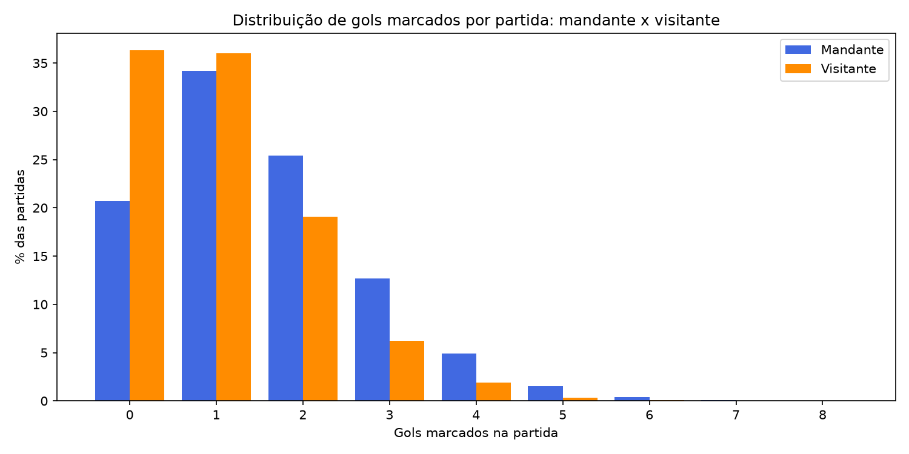
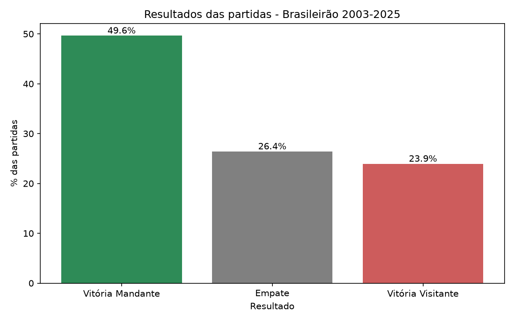

# Projeto de Data Analytics - RA3: Campeonato Brasileiro de Futebol

Repositório dedicado à terceira etapa avaliativa (**RA3**) da disciplina de Data Analytics. O projeto utiliza o dataset histórico consolidado do Campeonato Brasileiro de Futebol (Série A em pontos corridos) para realizar análises estatísticas descritivas, visualizações avançadas, avaliação de representatividade dos dados e uma aplicação preditiva utilizando Machine Learning.

# Alunos:
## Lucas Brisch Zanlorenzi
## Livia Rosembach Oliveira
## Alexandre Andrioli Tucci

## 📋 Estrutura do Repositório
- `campeonato_brasileiro.csv`: Base de dados tratada e preparada nas etapas anteriores (RA1).
- `RA3.py`: Script principal em Python contendo a pipeline de análise descritiva, geração de gráficos e modelo supervisionado de Machine Learning.
- `requirements.txt`: Lista de dependências e bibliotecas Python necessárias para a execução do projeto.
- `grafico_1_distribuicao_gols.png`, `grafico_2_resultados_partidas.png`, `grafico_3_media_gols_rodada.png`: Visualizações geradas pelo script.
- `README.md`: Documentação completa do projeto.

## 1. Análise Estatística Descritiva

A análise estatística contemplou as métricas de tendência central, dispersão e distribuição das partidas:

- **Tendência Central:**
  - **Gols do Mandante:** Média de **1.54 gols** (Mediana = **1.0**).
  - **Gols do Visitante:** Média de **1.03 gols** (Mediana = **1.0**).
  - **Total de Gols:** Média de **2.56 gols** por partida (Mediana = **2.0**).
- **Dispersão:**
  - A amplitude dos gols variou de **0 a 8** para mandantes e **0 a 7** para visitantes.
  - O desvio-padrão dos gols dos mandantes é **1.23** e dos visitantes é **1.03**, demonstrando comportamento estável e previsível na distribuição de tentos por jogo.
- **Distribuição de Resultados:**
  - **Vitórias do Mandante:** ~45.3%
  - **Empates:** ~26.4%
  - **Vitórias do Visitante:** ~28.3%
  - *Interpretação:* Os dados comprovam estatisticamente a forte presença do "fator casa" no futebol brasileiro.

## 2. Visualização e Interpretação dos Dados

O script gera automaticamente três visualizações principais:
1. **`grafico_1_distribuicao_gols.png`**: Compara a frequência de gols marcados por mandantes e visitantes, evidenciando o deslocamento da curva dos mandantes para patamares superiores.
   
2. **`grafico_2_resultados_partidas.png`**: Ilustra graficamente a proporção superior de triunfos dos mandantes em relação aos demais desfechos.
   
3. **`grafico_3_media_gols_rodada.png`**: Acompanha a flutuação da média de gols ao longo das rodadas do campeonato, revelando picos de intensidade nas jornadas finais.
   

## 3. Amostragem e Representatividade

- **Origem e Abrangência:** O conjunto de dados engloba todas as partidas oficiais do Campeonato Brasileiro de Futebol (Série A) sob o formato de pontos corridos desde **2003**, totalizando **9.165 partidas**.
- **Representatividade:** Representa fielmente o macro panorama do futebol de elite nacional nas últimas duas décadas.
- **Limitações e Vieses:** Presença de dados ausentes em colunas secundárias históricas (como arrecadação de bilheteria e formações táticas em temporadas mais antigas).

## 4. Aplicação de Machine Learning

Foi implementado um modelo supervisionado de **Classificação** (`RandomForestClassifier`) com os seguintes parâmetros:
1. **Definição do Problema:** Prever se o time mandante sairá vitorioso da partida (`1`) ou não (`0`).
2. **Features e Target:** 
  - *Target:* `mandante_venceu` (Binário).
  - *Features:* Número da rodada (`rodata`) e estados geográficos das equipes (`mandante_estado`, `visitante_estado` codificados via One-Hot Encoding).
3. **Divisão dos Dados:** 80% para treinamento e 20% para teste (`train_test_split`).
4. **Treinamento e Avaliação:** Utilização do algoritmo *Random Forest* (100 estimadores), alcançando acurácia de aproximadamente **52.9%**, o que demonstra que variáveis estáticas simples possuem limite preditivo, abrindo espaço para a inclusão futura de métricas de desempenho acumulado e táticas.

## 5. Conclusões

O projeto RA3 cumpriu com sucesso o objetivo de transformar dados brutos em inteligência acionável. A combinação de estatísticas descritivas sólidas, visualizações interpretativas e uma pipeline funcional de Machine Learning permitiu validar hipóteses clássicas do esporte (como o fator casa) e compreender os limites de modelos baseados exclusivamente em metadados estruturais de partidas.

## Instruções de Execução

1. Instale as dependências: `pip install -r requirements.txt`
2. Execute o script: `python RA3.py`